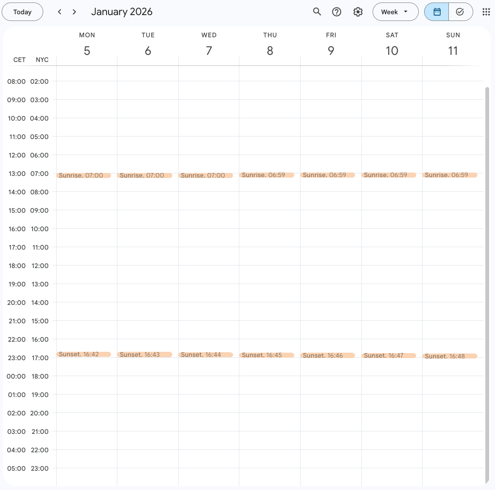

# daylight-calendar

Generate a calendar of daylight (sunrise to sunset) for any place and date range, as an `.ics` file to import into Google Calendar or Apple Calendar, or as CSV.

With daylight showing as a block on each day of your calendar, you can see at a glance when it's light out next to your schedule. That makes it easy to plan runs, walks and other time outside, especially as the days get shorter. It works for planning location photography too: add `--golden-hour` and `--blue-hour` to see the best light each morning and evening.



*Brooklyn, January 2026, generated with `--separate-events` and imported into Google Calendar.*

## Install

Requires Python 3.9 or later.

```sh
pip install -r requirements.txt
```

`geopy` is optional: it's only needed to look up places by name with `--location`. Use `--lat`/`--lon` if you don't want it.

## Usage

```sh
# Look up a place by name
python3 create_daylight_calendar.py --location "Brooklyn, NY" -s 2026-01-01 -e 2026-12-31

# Use exact coordinates instead (no network call)
python3 create_daylight_calendar.py --lat 40.66545 --lon -73.98875 -s 2026-01-01 -e 2026-12-31

# Two 30-minute events per day, ending at sunrise and at sunset, instead of one daylight block
python3 create_daylight_calendar.py --location "London, UK" -s 2026-01-01 -e 2026-03-31 --separate-events

# Add golden hour and blue hour, morning and evening, for photography
python3 create_daylight_calendar.py --location "Brooklyn, NY" -s 2026-01-01 -e 2026-03-31 --golden-hour --blue-hour

# CSV instead of ICS, with a custom output name
python3 create_daylight_calendar.py --location "Paris" -s 2026-01-01 -e 2026-03-31 -f csv -o paris.csv
```

| Option | Meaning |
| --- | --- |
| `-l`, `--location` | Place name to look up, such as `"Brooklyn"` or `"London, UK"` |
| `--lat`, `--lon` | Coordinates, as an alternative to `--location` (both required) |
| `-s`, `--start` / `-e`, `--end` | Date range, `YYYY-MM-DD`, inclusive |
| `-f`, `--format` | `ics` (default) or `csv` |
| `-o`, `--output` | Output file (default: `daylight_calendar.ics` or `daylight_calendar.csv`) |
| `--separate-events` | Sunrise and sunset events instead of one daylight event |
| `--golden-hour` | Also add golden hour events: sun from 4° below to 6° above the horizon |
| `--blue-hour` | Also add blue hour events: sun from 6° to 4° below the horizon |

Golden and blue hour use the definitions of the [astral](https://astral.readthedocs.io/) library. Morning blue hour runs straight into golden hour, and evening golden hour into blue hour. Because golden hour starts with the sun slightly below the horizon, it overlaps sunrise and sunset.

The time zone is detected from the coordinates, and times are local, including across daylight saving changes. Events are private and marked as free, so they don't block your calendar. Events that don't happen on a given day are skipped. Near the poles, a day can have no sunrise yet still have a blue hour.

**Importing:** in Google Calendar, go to Settings → Import & export and consider importing into a new calendar of its own, so you can hide or delete it in one step. In Apple Calendar, use File → Import. The CSV columns follow Google Calendar's CSV import format.

**Geocoding:** `--location` sends the place name to OpenStreetMap's [Nominatim](https://nominatim.org/) service, so it needs a network connection and is subject to Nominatim's [usage policy](https://operations.osmfoundation.org/policies/nominatim/).

## Tests

```sh
pip install pytest
python3 -m pytest
```

## License

MIT
